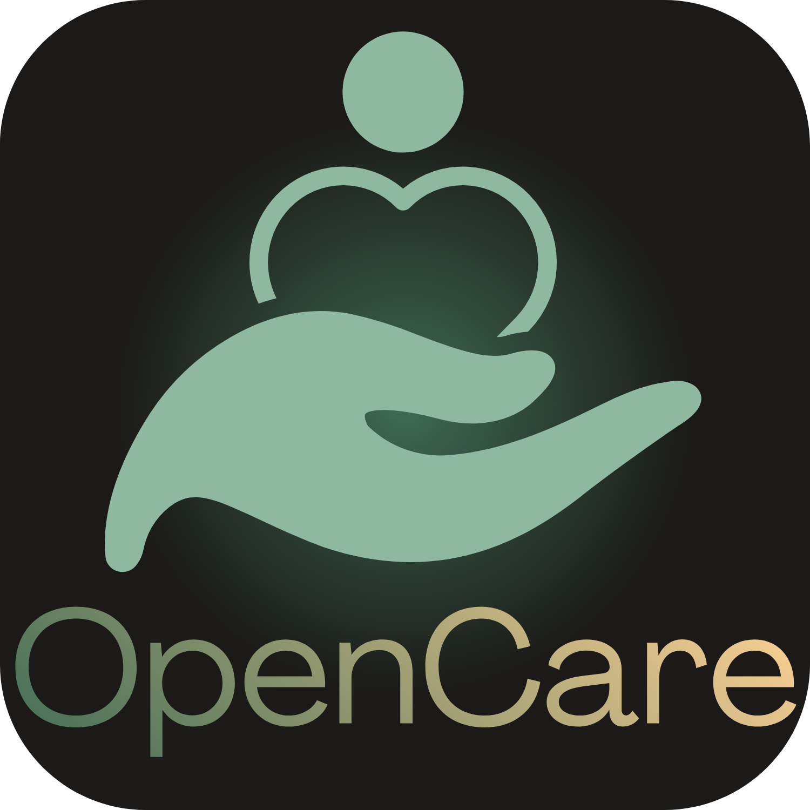

<div align="center">
  
  <h1>OpenCare</h1>
  <p><strong>La aplicación de código abierto y autoalojada para coordinar a los cuidadores familiares</strong><br>
  Coordine el círculo que rodea a un familiar mayor. En su servidor, con sus datos.</p>

  🇬🇧 <a href="README.md">English</a> · 🇫🇷 <a href="README.fr.md">Français</a> · 🇪🇸 <strong>Español</strong>

  [](https://github.com/NexaFlowFrance/OpenCare/releases/latest)
  [](https://github.com/NexaFlowFrance/OpenCare/actions/workflows/ci.yml)
  [](licence.md)
  [](https://github.com/NexaFlowFrance/OpenCare)

  <p>
    <a href="https://nexaflowfrance.github.io/OpenCare/demo/"><strong>Demo en línea</strong></a> ·
    <a href="https://nexaflowfrance.github.io/OpenCare/"><strong>Sitio del proyecto</strong></a> ·
    <a href="DOCUMENTATION.md"><strong>Documentación</strong></a> ·
    <a href="ROADMAP.md"><strong>Hoja de ruta</strong></a>
  </p>
  <p><em>La demo funciona íntegramente en su navegador con datos de ejemplo. No se guarda nada y no se envía nada a ningún sitio.</em></p>
</div>

---

OpenCare es una **alternativa autoalojada a las aplicaciones para cuidadores como Jointly o CaringBridge**:
un círculo de cuidados alrededor de cada persona cuidada, un diario de cuidados en tiempo real, los
medicamentos con sus recordatorios, una agenda compartida, el reparto de gastos entre hermanos, y
herramientas que nadie más ofrece: enlaces mágicos para que los profesionales escriban sin cuenta, una
ficha de urgencias en QR en la nevera, una tableta de pared para la persona cuidada. Todo en **su**
servidor: los datos de salud de una persona vulnerable no deberían estar en la nube de otro.

## ✨ Funciones

### La base

| | |
|---|---|
| 👥 **Círculo de cuidados** | Un círculo por persona cuidada, invitación por enlace, roles precisos (familia, profesional, vecino, solo lectura). Varios círculos desde el primer día: acompañe a sus dos padres, o vincule dos círculos en un **hogar** (una pareja) con un panel combinado |
| 📔 **Diario de cuidados** | El cuaderno de enlace digital: entradas fechadas con fotos, en tiempo real en todos los dispositivos (WebSocket). El corazón de la aplicación |
| 💊 **Medicamentos** | Tratamientos y horarios, confirmación de la toma anotada en el diario, alertas de renovación de recetas |
| 📅 **Agenda compartida** | Visitas, citas médicas, pasos de enfermería, recurrencias, recordatorios, exportación iCal (.ics / webcal) |
| ❤️ **Seguimiento de salud** | Constantes anotadas a mano (peso, tensión arterial, dolor, estado de ánimo, temperatura, glucemia, saturación de oxígeno, frecuencia cardiaca), curvas a lo largo del tiempo |
| ✅ **Tareas y compras** | Quién hace qué esta semana, y una lista de la compra compartida que también puede usar la auxiliar a domicilio |
| 💬 **Mensajes** | Hilo del círculo y mensajes directos, archivos adjuntos |
| 📁 **Documentos y contactos** | Recetas, informes, seguro, documentos legales; la libreta de direcciones del círculo (médico de cabecera, enfermería, la vecina que tiene la llave) |

### Más allá de las aplicaciones de pago

| | |
|---|---|
| 💶 **Gastos compartidos** | Un Tricount integrado: quién adelantó qué, saldos, liquidaciones sugeridas, y seguimiento de las ayudas francesas (APA, CESU, crédito fiscal) |
| ⚖️ **Reparto de la carga** | «Marie cubrió el 78 % de las visitas este mes»: cifras objetivas para prevenir el agotamiento del cuidador principal |
| 🔗 **Enlaces mágicos** | La auxiliar a domicilio o la enfermera escribe en el diario desde un simple enlace (SMS/QR), sin cuenta y sin instalar nada |
| 🩺 **Preparación de la consulta** | Con un clic: un resumen imprimible para el médico (hechos destacados, evolución de las constantes, tratamientos actuales, las preguntas de la familia) |
| 🖥️ **Modo Kiosco** | Una tableta de pared en casa de su familiar: quién viene hoy (con fotos), recordatorios de medicamentos en grande, el tiempo, y dos botones enormes: «Todo va bien» / «Necesito ayuda» |
| 🚨 **Ficha de urgencias QR** | Un QR impreso en la nevera: los servicios de emergencia lo escanean y ven la ficha vital (tratamientos, alergias, directivas, contactos), siempre al día |
| 📖 **«Quién soy»** | Una página con la historia de vida (oficio, orgullos, costumbres, lo que le tranquiliza) que se muestra a cada nuevo cuidador, inspirada en el documento «This is me» de la Alzheimer's Society |
| 🧳 **Modo relevo** | El cuidador principal se va una semana: un paquete de relevo generado automáticamente (agenda, medicamentos, instrucciones, contactos) que se comparte por enlace |
| 🏠 **Vigilancia pasiva** | Webhooks de Home Assistant (sensor de puerta, enchufe de la cafetera, movimiento): «actividad normal esta mañana» en el panel de la familia, cascada de alertas si no hay señales de vida. Sin cámara ni pulsera |
| 🎙️ **Diario de voz** | Dicte al salir («visita de 20 minutos, todo bien, comprar paracetamol»): su Whisper autoalojado transcribe, la IA archiva la entrada del diario y el artículo de la compra |
| 🤖 **Resumen semanal con IA** | Cada domingo: «Semana tranquila. 5 visitas. Tensión estable. Atención: 2 tomas olvidadas el martes y el jueves.» Con detección de tendencias lentas (ánimo bajo recurrente, pérdida de peso gradual) |
| 🌡️ **Ola de calor** | Declare un episodio de calor en un toque: lista de prevención en el panel y en el kiosco, recordatorios de hidratación a los cuidadores a las horas elegidas, y un botón «Ya bebí agua» en el kiosco |
| 🗣️ **Acompañante IA** | Un acompañante de voz opcional con el que la persona cuidada charla desde el kiosco: recuerdos evocados con suavidad a partir de la página «Quién soy», entrada de voz (su Whisper) y lectura en voz alta. Límites estrictos (nunca da consejos médicos, avisa al círculo si detecta angustia). Local primero con Ollama, o con su propia clave en la nube |

### Hecha para ser suya

- **Autoalojada**: Docker, o un **instalador de Windows en un clic** (Node.js y PostgreSQL incluidos)
- **PWA que tolera la falta de conexión**: funciona en la habitación de una residencia con poca cobertura
- **IA local primero**: Ollama en su máquina, o su propia clave de Anthropic / compatible con OpenAI, cifrada en reposo
- **Exportación completa** de todos los datos del círculo, licencia **AGPL-3.0**
- Interfaz en **francés, inglés y español**, accesible con el teclado y compatible con lectores de pantalla

## 🚀 Inicio rápido

### 🪟 Instalador de Windows (.exe)

Para Windows, **NexaFlow** ofrece un instalador gráfico todo en uno: Node.js y PostgreSQL vienen
incluidos, sin Docker ni configuración.

Descargue `OpenCare-Setup.exe` desde la [última versión](https://github.com/NexaFlowFrance/OpenCare/releases/latest),
ejecútelo y haga clic en **Démarrer** (Iniciar): la aplicación se abre en http://localhost:3000. La
ventana muestra también su dirección de red local, para que el resto de la familia la abra desde el
móvil en la misma red Wi-Fi.

### 🐳 Docker (recomendado para un servidor)

```bash
cp .env.example .env   # defina POSTGRES_PASSWORD y JWT_SECRET
docker-compose up -d --build
```

- Interfaz: http://localhost:3000
- API: http://localhost:3001

### 💾 Copias de seguridad

Todo vive en PostgreSQL, así que un volcado es una copia completa. Guarde su `.env`
(secretos JWT y VAPID) en otro lugar, o añada `--with-env` para copiarlo junto al volcado.

```bash
bash scripts/backup.sh              # volcado comprimido y verificado en ./backups
bash scripts/restore.sh <archivo>   # lo restaura, tras una copia de seguridad previa
```

Prográmelo en cron y copie los archivos fuera de la máquina. Las opciones están en
[DOCUMENTATION.md](DOCUMENTATION.md).

### 🛠️ Desarrollo

En Windows, lo más sencillo no necesita Docker: el script arranca el PostgreSQL
incluido, escribe un `.env` de desarrollo y lanza la aplicación.

```powershell
npm install
powershell -ExecutionPolicy Bypass -File scripts\dev-windows.ps1
```

En macOS o Linux (o Windows con Docker):

```bash
npm install
docker-compose up -d postgres   # o cualquier PostgreSQL 14+
cp .env.example .env            # defina JWT_SECRET (32+ caracteres) y POSTGRES_PASSWORD
npm run dev
```

- Interfaz: http://localhost:5173 · API: http://localhost:3001

El esquema de la base de datos se crea solo en el primer arranque: no hay ningún paso SQL manual.
`npm run dev` necesita un `.env` en la raíz del proyecto (en Windows, el script anterior lo crea
por usted).

## 🆚 ¿Por qué OpenCare?

|  | OpenCare | Jointly / CaringBridge |
|---|---|---|
| Sus datos en su servidor | ✅ | ❌ |
| Código abierto (AGPL-3.0) | ✅ | ❌ |
| Gratis, sin suscripción | ✅ | ⚠️ |
| Los cuidadores escriben sin cuenta (enlace mágico) | ✅ | ❌ |
| Gastos compartidos y reparto de la carga | ✅ | ❌ |
| Modo Kiosco para la persona cuidada | ✅ | ❌ |
| Vigilancia pasiva con Home Assistant | ✅ | ❌ |

## 🧰 Tecnologías

**Frontend**: React 19 · TypeScript · Vite 7 · TailwindCSS · Radix UI · i18next · PWA (service worker, web push, sin conexión)
**Backend**: Node.js 20 · Express · PostgreSQL 14+ (esquema que se crea solo) · WebSocket · Web Push (VAPID) · JWT + bcrypt 12 · helmet · rate limiting
**DevOps**: Docker Compose · GitHub Actions · Instalador de Windows con Inno Setup

## 🔐 Seguridad

Autenticación JWT (7 días) · contraseñas con hash **bcrypt (coste 12)** · control del rol por
círculo en cada petición · cabeceras HTTP seguras con **helmet** · límite de peticiones en la
autenticación · CORS estricto y configurable · validación de las entradas en el servidor · claves
de IA cifradas en reposo (AES-256-GCM) · registros estructurados.

## 🤝 Contribuir

¡Las contribuciones son bienvenidas! Empiece por [CONTRIBUTING.md](CONTRIBUTING.md): explica la
instalación local, las comprobaciones que hay que pasar antes de abrir una pull request y las
invariantes que no se deben romper. La especificación del producto está en [docs/SPEC.md](docs/SPEC.md).

¿Busca una primera contribución? La etiqueta
[good first issue](https://github.com/NexaFlowFrance/OpenCare/issues?q=is%3Aopen+label%3A%22good+first+issue%22)
es el lugar para empezar. Las traducciones a un nuevo idioma son especialmente bienvenidas: añada una
carpeta `client/src/i18n/locales/<código>/` y el idioma aparece solo en el selector.

## 📄 Licencia

GNU Affero General Public License v3.0 (AGPL-3.0-only), consulte [licence.md](licence.md).

## 🙏 Créditos

Creado y mantenido por [NexaFlow France](https://nexaflow.fr), y ofrecido a todas las familias
que cuidan de alguien.

OpenCare se basa en el código abierto de [OpenFamily](https://github.com/NexaFlowFrance/OpenFamily),
el organizador familiar autoalojado de NexaFlow. Los círculos, la capa de tiempo real, el cliente que
funciona sin conexión y todo el autoalojamiento vienen de esa base, rehechos en torno al cuidado de un
familiar.

Gracias a [mpking828](https://github.com/mpking828) por alinear la zona horaria del servidor con la de
la base de datos, por la ficha de urgencias multilingüe y por sus precisos informes de errores desde un
hogar fuera de Francia.

Un agradecimiento especial a [thecybermacgyver](https://github.com/thecybermacgyver), cuya revisión a
fondo del producto y cuyas maquetas del kiosco dieron forma a la experiencia del paciente en la versión 1.2.
